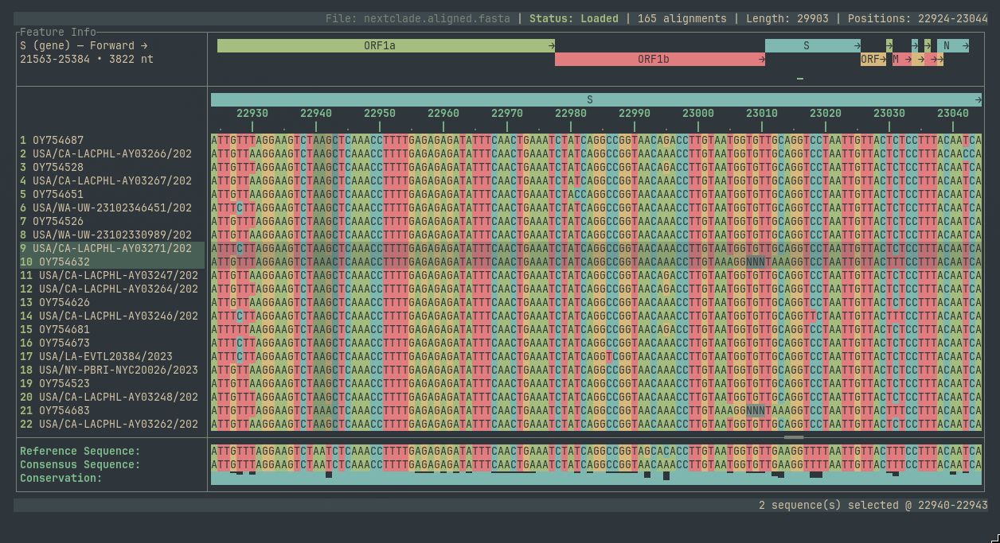
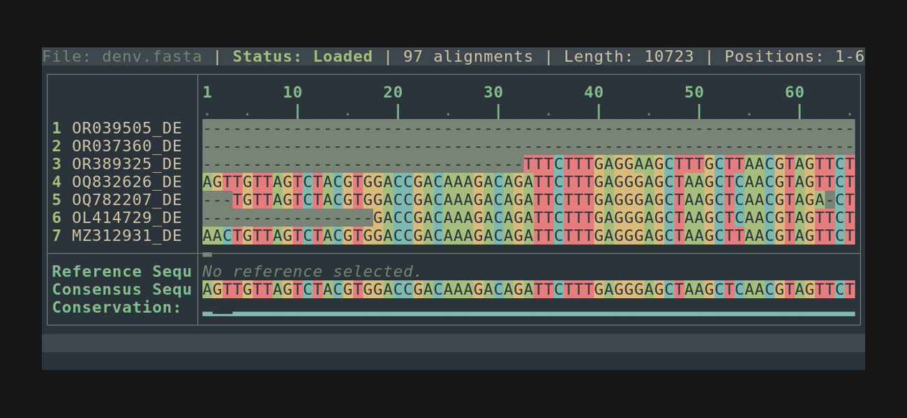
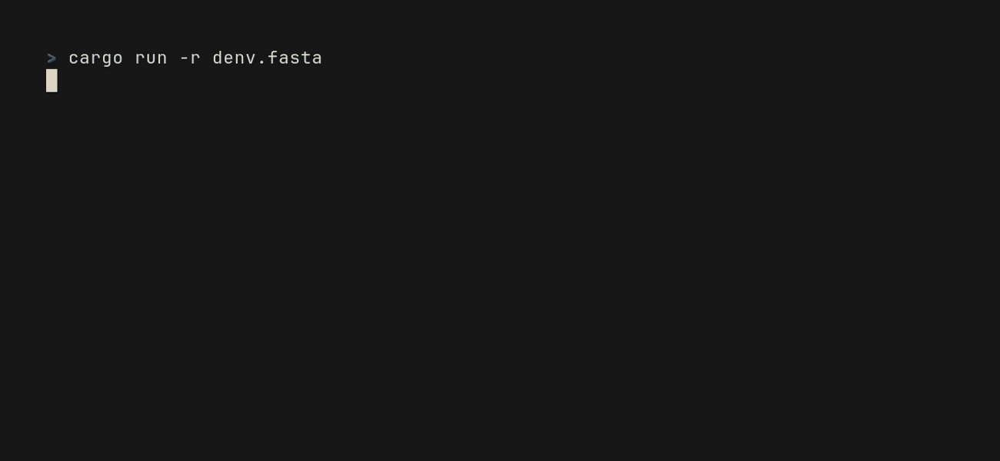
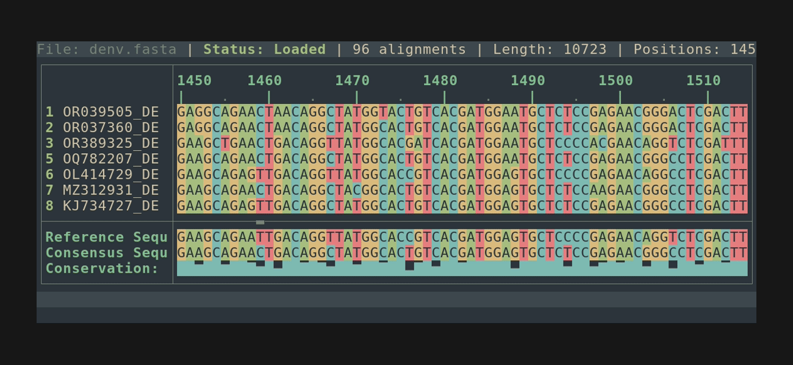
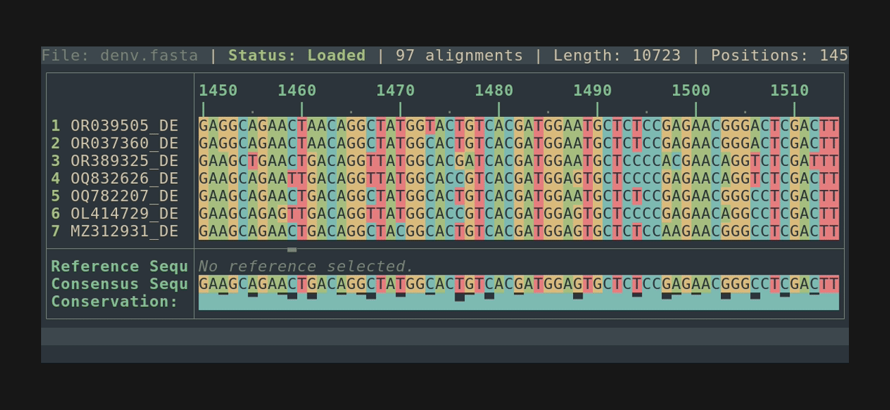
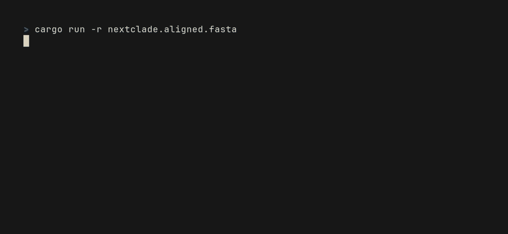

[](https://github.com/Sam-Sims/salti/actions/workflows/test.yaml)
[](https://github.com/Sam-Sims/salti/actions/workflows/check.yaml)

<h1 align="center">salti</h1>

<p align="center">
  
</p>

salti is a multiple sequence alignment browser for the terminal. It aims to be fast and feature rich, designed to work on remote servers such as HPC environments, or anytime you dont want to leave the terminal.

## Quick start

If using linux/macOS

```bash
curl --proto '=https' --tlsv1.2 -LsSf https://github.com/Sam-Sims/salti/releases/download/salti-0.9.0/salti-installer.sh | sh
```

or conda (All supported platforms)

```bash
conda install -c bioconda salti
```

## Contents

- [Why](#Why?)
- [Feature showcase](#feature-showcase)
- [Installation](#installation)
- [Usage](#usage)
- [Some notes on features](#some-notes-on-features)

## Why?

Large alignments are generally built utilising the compute capacity of a HPC. Once built, looking at them usually involves downloading them to open in a local GUI or web based app. If you're feeling brave, you might even attempt to wrangle X forwarding (which I could never get to work). All in all this is particularly cumbersome with large alignments and in some cases this isnt allowed at all - think data governance rules in trusted research environments.

salti lets you browse fasta alignments from the terminal. It runs as a single binary on a remote server and can be used anywhere you can get a terminal. I've even used it in the web terminal that Jupyter gives you.

## Feature showcase

<sub>Click a feature to expand its description and preview.</sub>

<details>
<summary><b>Command palette</b></summary>

Press `:` to open a command palette. Every action is available here, including those without a keybinding. Supports fuzzy matching and tab completion for arguments. If you have used helix, this should hopefully feel familiar.

See [Usage](#command-palette) for the full list of commands



</details>

<details>
<summary><b>Mouse support</b></summary>

Click a sequence or position to select it, or Ctrl+click to select a region. Hold the middle button and drag to pan around the alignment.



</details>

<details>
<summary><b>Minimap</b></summary>

Press `m` to open an overview of the entire alignment. Click or drag to move around.



</details>

<details>
<summary><b>Translation</b></summary>

Translate codons to amino acids on the fly, with support for all 6 frames (`+1` to `+3` and `-1` to `-3`). The overlay shows amino acids on top of the nucleotide codons, and the protein view lets you browse the whole alignment as protein symbols.



</details>

<details>
<summary><b>Useful viz tools</b></summary>

- Collapse positions that match the reference or consensus to `.` for easier visualisation of differences.
- Mouse selection to highlight regions or sequences
- Pin important sequences fixed at the top while browsing.
- Hide gappy or constant columns, and filter rows by regex.


</details>

<details>
<summary><b>GFF support</b></summary>

Load GFF3 annotations to see features in a pane covering the whole alignment and in a track above the sequences. Hover over a feature for its details, or jump to one with jump-feature.

This is experimental currently. Only gene features are shown, and annotations apply to the whole alignment rather than to individual sequences. See [GFF support](#gff-support) for scenarios where that works well.



</details>

<details>
<summary><b>Themes</b></summary>

salti picks a light or dark theme to match your terminal, and comes with a few others (everforest, solarized and tokyo night). If your terminal doesn't support 24-bit colour, use ansi, which uses your terminal's own colours.

Change theme with set-theme.


</details>

<details>
<summary><b>Transparent support for HTTP/SSH/Compressed files</b></summary>

Open compressed FASTA files, or load them straight from a URL or over SSH:
```
:load sequences.fasta.gz
:load https://example.com/alignment.fasta
:load ssh://user@host/path/to/alignment.fasta
```

This comes from the excellent [paraseq](https://github.com/noamteyssier/paraseq)  library.

</details>

## Installation

### Conda:


```
conda install -c bioconda salti
```

### Binaries:

Precompiled binaries for Linux, MacOS and Windows are attached to the latest release.

You can also use the installer script:

```bash
curl --proto '=https' --tlsv1.2 -LsSf https://github.com/Sam-Sims/salti/releases/download/salti-0.8.0/salti-installer.sh | sh
```

### Cargo:

Requires [cargo](https://www.rust-lang.org/tools/install)

```bash
cargo install salti
```

### Build from source:

#### Install rust toolchain:

To install please refer to the rust documentation: [docs](https://www.rust-lang.org/tools/install)

#### Clone the repository:

```bash
git clone https://github.com/Sam-Sims/salti
```

Note: `main` may contain active development, so it could contain unfinished or broken features. If you want a specific version, check out a release tag (e.g. `git checkout salti-0.9.0`) or grab it from the [releases](https://github.com/Sam-Sims/salti/releases) page.

#### Build and add to path:

```bash
cd salti
cargo build --release
export PATH=$PATH:$(pwd)/target/release
```

All executables will be in the directory `salti/target/release`.

## Usage

I would recommend a modern terminal, with GPU acceleration and 24-bit colour (true colour) support for the best experience. Additionally, a font with Unicode support is required to render all characters correctly.

I would also recommend a large terminal window for the best experience, but the app is designed to be usable even in smaller windows.

`salti` is primarily developed and benchmarked in [Ghostty](https://ghostty.org/). I have tested it on several other terminals and it works well in most cases, though performance may vary. If you have responsiveness issues, please open an issue and include your terminal emulator and font information.

Note: If you're using Ghostty 1.3.0+ and the middle mouse button isn't working, check that gtk-enable-primary-paste is enabled:
```
gsettings set org.gnome.desktop.interface gtk-enable-primary-paste true
```
See [here](https://github.com/ghostty-org/ghostty/discussions/12181) for details.

### How to run

```bash
salti <alignment.fasta>
```

If no file is passed, the app starts and waits for you to load one via the command palette.

## Quick start keybinds

Use `?` in app to open the help page.

### Global keybindings

- `q` - Quit.
- `:` - Opens the command palette.
- `Up` / `Down` - Scroll vertically 1 row
- `Left` / `Right` - Scroll horizontally 1 column.
- `Shift` + `Left`/`Right`/`Up`/`Down` scrolls 10 columns/rows in that direction.
- `Alt+Left` / `Alt+Right` - Scroll sequence name pane.
- `Left click` - Select a sequence or position. Click again to clear selection.
- `Ctrl + Left click` - Select a range of sequences or positions
- `Middle click + drag` - Pan.
- `m` - Open the minimap
- `t` - Toggle the translation overlay.
- `Shift+t` - Toggle the protein view.
- `Alt+1|2|3` - Change to forward reading frame `+1`, `+2` or `+3`.
- `Alt+4|5|6` - Change to reverse reading frame `-1`, `-2` or `-3`.
- `d` - Cycle the diff mode.
- `?` - Open keybinds help.

### Command palette

Most features can be accessed through the command palette (this is heavily inspired by the helix editors implementation!).

Open with `:`, then type a command.

- `Enter` runs the command, or lists the contents of a selected directory if selected via tab.
- `Tab` / `Shift+Tab` cycles completions.
- `Esc` closes the palette.

Commands:

- `jump-position` - Jump to a 1-based alignment position. If that column is hidden by a filter, jumps to the next shown column.
- `jump-sequence` - Jump to a sequence by name
- `jump-feature` - Jump to a feature if a GFF file has been loaded.
- `pin-sequence` - Pin a visible sequence to the top of the alignment view.
- `unpin-sequence` - Remove a sequence from the pinned group.
- `filter-rows` - Filter rows by their IDs (fasta headers) via regex. With no argument, clears the row filter.
- `filter-gaps` - Filter columns by their gap percentage.
- `filter-constant` - Filter columns by their similarity.
- `clear-all-filters` - Clear the row filter and both column filters.
- `set-reference` - Set a reference sequence.
- `clear-reference` - Clear the reference sequence.
- `toggle-translation-overlay` - Toggle the amino acid overlay on the nucleotide view.
- `toggle-protein-view` - Toggle between the nucleotide alignment and its translated protein alignment.
- `set-diff-mode` - Set diff rendering mode (`off`, `reference`, or `consensus`).
- `load-alignment` (alias: `load`) - Load an alignment file.
- `load-gff` - Load a GFF3 annotation file.
- `set-consensus-method` - Choose `majority` or `majority-non-gap`.
- `set-translation-frame` - Set translation frame (`+1`, `+2`, `+3`, `-1`, `-2` or `-3`).
- `set-theme` - Set active theme (`auto`, `everforest-dark`, `everforest-light`, `solarized-dark`, `solarized-light`, `tokyo-night`, or `ansi`).
- `set-sequence-type` - Override auto-detection if it fails (`dna`, `protein`, or `generic`).
- `check-update` - Check for updates and show the latest version.
- `keybinds` - Open the keybinds help page.
- `quit` - Quit the app.

## Some notes on features

*until I write proper docs*

### Fuzzy matching

All commands that take string input support fuzzy matching. For example, `jump-sequence` will match any sequence name that contains the input string. If multiple candidates match, you can cycle through them with `Tab` / `Shift+Tab`.

### Consensus method

Two methods are available for consensus calculation:

- `majority` - The most common character at each position, including gaps.
- `majority-non-gap` - The most common character at each position, excluding gaps

If there is a tie for most common character, the lowest ASCII value wins. For example this means `A` beats `C`, uppercase beats lowercase (`T` beats `a`), and under `majority` a gap (`-`) beats any letter.

The default is `majority-non-gap`

### Translation overlay vs protein view

`salti` offers two ways of translating. The first is the translation overlay, toggled by pressing `t` or the `toggle-translation-overlay` command.

The overlay maps the currently visible nucleotides into their respective codons according to the current frame and then renders them as an 3 wide amino acid overlay. This does not change the coordinate space - and the ruler will stay in nucleotides. Clicking on an amino acid however will display the coordinate in protein space in the bottom status bar for reference.

Importantly the translation overlay can not be used if any of the columns have been filtered - as this would cause frameshifts and would not make sense to represent visually.

In contrast the protein view (`Shift+T` or the `toggle-protein-view` command) shows the full alignment as protein symbols, as if you had loaded a fasta with the translated amino acids instead of nucleotides. This means the coordinate space becomes amino acids - and each amino acid is represented by one column. This means the protein view is compatible with column filtering, unlike the translation overlay.

Codons are translated as they are drawn, so switching is instant even on large alignments, and it is useful to switch between the two types depending on what is useful.

Reading frame can be changed at any time using `Alt+1` to `Alt+6`, or the `set-translation-frame` command.

### Gap filtering

`filter-gaps` hides columns whose gap fraction is above the threshold you give it. The threshold is a percentage, so `filter-gaps 25` removes columns where 25% of positions are gaps. You can use `filter-gaps 0` to clear the filter.

Gap filtering changes the visible coordinate space. The ruler marks jumps where hidden columns have been skipped. A single jump is shown with an arrow pointing towards the side that has a jump. Dense regions of skipped columns are shown as a run of `~` characters rather than individual arrows.

The translation overlay can't be used with any filter that hides columns, such as `filter-gaps` or `filter-constant`. Hiding columns would break up codons and cause frameshifts, so the overlay wouldn't show a meaningful translation. Turning on a filter while the overlay is on is rejected, and so is turning on the overlay while a filter is active. The protein view however (`toggle-protein-view`) does support column filtering.

### Constant filtering

`filter-constant` hides columns where any given value in the column meets the threshold you give it. Like gap filtering, the threshold is also a percentage so `filter-constant 100` hides columns where 100% of the positions are the same (i.e removes constant sites).

Like gap filtering - removing columns can change the visible coordinate space - see gap filtering for a more detailed breakdown of what that means.

`filter-constant 99` hides columns where 99% of the positions are the same and so on. `filter-constant 0` clears the filter.

NOTE: Gaps are ignored when calculating constant fractions, in DNA alignments `N` is also ignored and in protein, `X` is also ignored

### GFF support

`salti` can load and display GFF3 annotations from a file with the `load-gff` command. This is currently experimental.

At the moment only `gene` features are supported.

When a GFF is loaded `salti` will show:
- a global feature pane
- a local feature track above the alignment
- feature details in the `Feature Info` pane when you hover over a feature
- support for the `jump-feature` command in the command palette

You can also drag in the global feature pane to pan around the alignment.

Currently annotations are treated as "global" - and per sequence annotations are not supported. This also means there is no fancy business that tries to match GFF coordinates to gaps etc. This is mainly useful in specific use cases e.g:

When you have multiple alignments to a reference sequence where that reference does not have gaps inserted (i.e insertions are ignored). For example running mafft with something like `mafft --add --keeplength` or using alignments from something like [nextclade](https://github.com/nextstrain/nextclade) or [fastalign](https://github.com/Sam-Sims/fastalign).

In the normal nucleotide view, GFF coordinates are shown in nucleotide space. The translation overlay keeps this the same - because it is just an amino acid overlay on top of the nucleotide view. In the protein view, the features are projected into protein columns using the active reading frame.

If columns are filtered, features are projected onto the remaining visible columns. This means a feature can look compressed, or disappear entirely if all of its columns are filtered out.

### Pinned behaviour

- Pinned sequences stay visible and remain at the top, even when they do not match the active filter.
- Setting a sequence as reference removes it from pinned state.

### Data/Rendering

- Input must be FASTA with equal sequence lengths across records. A file with bad records is reported once the whole file has been read.
- Sequence type is auto-detected on load; you can override it if its wrong.
    - It samples up to 100 random alignments and compares NT and AA character fractions. If neither crosses 50%, it falls back to `generic` mode.

### Update check:

`salti` will check for updates on startup and notify you if a new version is available. It does this by querying the crates api: https://crates.io/api/v1/crates. However, no network connection is required to use `salti`, and will not cause any issues if the check fails.

This behaviour can be disabled entirely with `--skip-update-check`, or by setting `SALTI_SKIP_UPDATE_CHECK` to any value other than `false`, `no`, `off`, `0` or empty. You can still check for updates manually with the `check-update` command.
